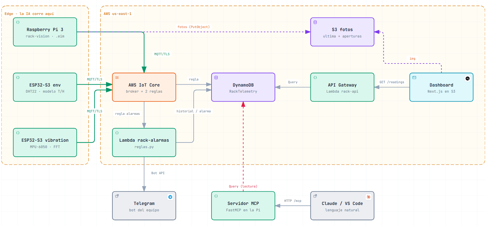

# iot-ai-mcp

<!-- Secciones exigidas por la Actividad 4: caso de uso, arquitectura, código, inconvenientes,
     resultados y conclusiones. Cada responsable completa la parte de su componente. -->

## Arquitectura

Versión interactiva (zoom, búsqueda y recorridos guiados): abrir
[`docs/arquitectura/arquitectura.html`](docs/arquitectura/arquitectura.html) en el navegador. Fuente
editable: `docs/arquitectura/arquitectura.json` (generado con Archify).

1. **Edge (la IA corre aquí).** La Raspberry Pi 3 clasifica la puerta con un modelo de Edge Impulse
   (`.eim`), la ESP32-S3 `rack01-env` clasifica temperatura/humedad y la ESP32-S3 `rack01-vibration`
   clasifica la vibración del ventilador. Solo viaja la predicción (`label`, `confidence`, `scores`).
2. **Ingesta.** Cada dispositivo publica por MQTT con TLS mutuo (certificado X.509 y política IoT
   propios) en `datacenter/rack01/{camera,env,vibration}`.
3. **AWS IoT Core** aplica dos reglas por mensaje: `rack_predicciones_to_dynamodb` guarda la fila en
   **DynamoDB `RackTelemetry`** (PK `device_id`, SK `ts`) y `rack_alarmas_to_lambda` invoca la Lambda
   **`rack-alarmas`**.
4. **Alarmas.** `rack-alarmas` lee el historial reciente en DynamoDB, aplica las reglas (3 predicciones
   anómalas seguidas, apertura de puerta, alarmas cruzadas), avisa por **Telegram** y guarda la alarma
   en la misma tabla (`device_id` `rack01-alarmas`).
5. **Fotos.** La Pi sube a **S3** la última foto y la de cada apertura (usuario IAM `rack-pi-fotos`,
   solo `PutObject`).
6. **Dashboard.** Next.js estático en S3; cada 10 s consulta **API Gateway → Lambda `rack-api` →
   DynamoDB** y muestra las fotos desde el bucket.
7. **MCP.** FastMCP corre en la Pi y consulta DynamoDB con un usuario IAM de solo lectura
   (`rack-mcp-lectura`). Claude o VS Code le preguntan en lenguaje natural por HTTP (`:8000/mcp`).

## Resultados

### Modelo 1 — Clasificación de imágenes (puerta del rack) · Raspberry Pi 3

**Clases**

| Clase | Significado |
|---|---|
| `puerta_abierta` | La puerta **no está cerrada**: incluye puertas entreabiertas y totalmente abiertas |
| `puerta_cerrada` | La puerta está completamente cerrada |

**Modelo**

- Proyecto de Edge Impulse: `juanxo17-project-1` · versión del modelo: **v3**
- Impulse: imagen de 96×96 px (*Fit shortest axis*) → bloque *Image* (RGB) → *Transfer Learning*
  (MobileNetV2 96×96, α = 0,35)
- Entrenamiento: 20 épocas, learning rate 0,0005, 20 % de validación, *data augmentation* activado
- Dataset: _pendiente_ (fotos por clase en entrenamiento y prueba, desde *Data acquisition*)

**Resultados en el set de prueba** (55 imágenes que el modelo nunca vio en el entrenamiento: 48
`puerta_abierta`, 7 `puerta_cerrada`; modelo float32)

Matriz de confusión (filas: clase real; columnas: clase predicha):

| Real \ Predicho | `puerta_abierta` | `puerta_cerrada` |
|---|---|---|
| `puerta_abierta` (48) | **46** | 2 |
| `puerta_cerrada` (7) | 0 | **7** |

| Métrica | `puerta_abierta` | `puerta_cerrada` |
|---|---|---|
| Precisión | 1,000 (46/46) | 0,778 (7/9) |
| Recall | 0,958 (46/48) | 1,000 (7/7) |
| F1 | 0,979 | 0,875 |

- **Accuracy: 96,4 % (53/55)** · F1 macro: 0,927 · ROC AUC: 0,979
- Fuente: `docs/metricas/imagenes/modelo-v3-validacion-y-prueba.json` (exportado de Edge Impulse)

**Vista de *Model testing* con umbral de confianza** _(versión int8 en pantalla; el JSON exportado no
incluye esta vista, así que estas cifras se tomaron de la pantalla de Edge Impulse)_

Edge Impulse aplica por defecto un **umbral de confianza de 0,6**. Si la probabilidad de la clase
ganadora no llega a ese umbral, la muestra no se asigna a ninguna clase y se cuenta como
**"uncertain"** (incierta). No es un acierto ni un error: el modelo "no se compromete". En el sistema
real, una predicción incierta no dispara la alarma de puerta abierta.

| Real | Bien clasificada | Como la otra clase | Uncertain |
|---|---|---|---|
| `puerta_abierta` (48) | 93,8 % (45) | 2,1 % (1) | 4,2 % (2) |
| `puerta_cerrada` (7) | 85,7 % (6) | 0 % (0) | 14,3 % (1) |

F1 en esa vista: `puerta_abierta` 0,97 · `puerta_cerrada` 0,86.

Las dos `puerta_abierta` inciertas, revisadas a mano:

- Una foto muy borrosa y tomada de lado: el problema es la captura, no el modelo.
- La puerta del clóset (la que simula la del rack) entreabierta, con la puerta de la habitación también
  abierta al fondo. Hay dos puertas en el cuadro y el modelo no sabe cuál mirar: aprendió "puerta
  abierta" en general, no "esta puerta". Con la cámara fija y el encuadre cerrado sobre la puerta del
  rack, ese fondo sale del cuadro.

**Validación frente a prueba.** En validación (22 imágenes: 14 abiertas y 8 cerradas) el modelo float32
acertó 22/22 (100 %) y el int8 acertó 21/22 (95,5 %; una cerrada predicha como abierta). La validación
fue más optimista que la prueba, así que **las cifras oficiales son las del set de prueba**.

**Análisis de errores (set de prueba, float32).** Los dos errores son puertas abiertas predichas como
cerradas:

1. `WIN_20261125_00_22_34_Pro_2.jpg`: foto movida, inclinada y con un dedo en el cuadro. Es un problema
   de captura y se retira del dataset por calidad.
2. `WIN_20261125_00_19_15_Pro_2.jpg`: puerta corrediza apenas entreabierta; a 96×96 px parece cerrada.
   Es una falla legítima y se conserva como caso límite.

**Limitaciones**

- El set de prueba está desbalanceado (48 contra 7): cada imagen de `puerta_cerrada` mueve sus
  métricas más de 14 puntos.
- Las fotos se tomaron con la cámara en la mano y muchas son casi idénticas, así que puede haber fuga
  entre entrenamiento y prueba que infle las métricas.
- Estas métricas corresponden al **modelo v3, antes de limpiar el dataset**. Se reemplazan al reentrenar
  con fotos de la cámara fija en su posición de la demo.

**En el dispositivo (Raspberry Pi 3, `armv7l`, Raspberry Pi OS Buster).** Medido con
`raspberry/vision/test_modelo.py` sobre 20 fotos (10 por clase) con el `.eim` de Edge Impulse (*Linux ARMv7*, *Unoptimized float32*):

| Medida | Valor |
|---|---|
| Inferencia (DSP + clasificación, reportada por el `.eim`) | media **15 ms** · máx. 23 ms |
| Ciclo completo (decodificar y redimensionar con `ffmpeg` + inferencia) | media **1,24 s** |
| RAM del proceso del modelo (VmRSS) | **42,9 MB** (de ~750 MB libres) |
| Arranque del modelo | 0,1 s |

La inferencia es barata: casi todo el ciclo se va en `ffmpeg` decodificando fotos de alta resolución.
Aun así cabe de sobra en el ciclo de 5 s. Las 20 fotos salieron con la clase de su carpeta. Dos quedaron
bajo el umbral de 0,6 (0,553 y 0,531) y en el servicio se tratan como inciertas: no cambian el estado.
Varias de estas fotos pueden haberse usado en el entrenamiento, así que esta prueba valida la latencia y
el despliegue, **no la exactitud**.

Detalle de inconvenientes: [`docs/inconvenientes.md`](docs/inconvenientes.md).
