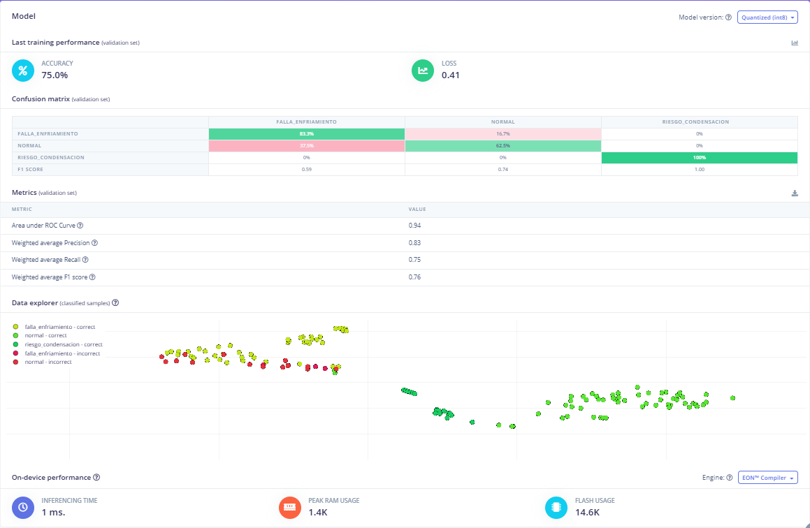
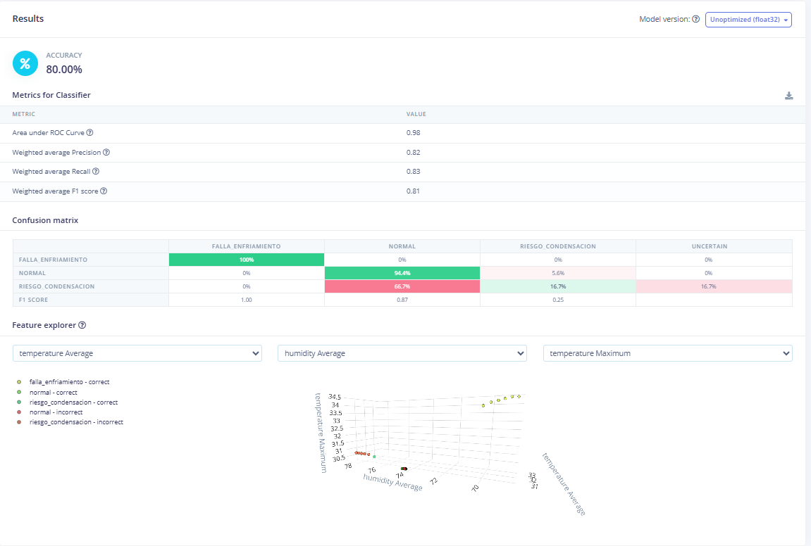

# esp32/env — Thing `rack01-env` (ESP32-S3 + DHT22)

Este módulo mide temperatura y humedad del rack y clasifica, dentro del ESP32-S3, la tendencia de los últimos 2 minutos. El resultado se publica por MQTT con TLS a AWS IoT Core.

Etiquetas del modelo:

| Etiqueta | Qué representa |
|---|---|
| `normal` | Temperatura y humedad estables. |
| `falla_enfriamiento` | La temperatura sube de forma sostenida. |
| `riesgo_condensacion` | La humedad sube con claridad. |

El modelo no pronostica valores. Mira la forma de la ventana de 2 minutos y dice qué patrón es.

## Carpetas

| Carpeta | Para qué sirve |
|---|---|
| `captura_env/` | Programa de captura. Imprime `temperatura,humedad` cada 2 s por Serial, para subirlo a Edge Impulse. |
| `clasificador_env/` | Prueba del modelo en la placa, solo por Monitor Serie (sin red). |
| `rack01_env/` | **Firmware final**: DHT22 + modelo + WiFi + MQTT/TLS. |
| `lib/` | Librería de Arduino exportada de Edge Impulse (el modelo). |
| `docs/` | Capturas de resultados. |

## Cómo compilar `rack01_env`

1. Arduino IDE con el paquete de placas **esp32** y la placa **ESP32S3 Dev Module**.
2. Librerías: **DHT sensor library** (Adafruit), **PubSubClient** (Nick O'Leary) y el modelo (`Sketch > Include Library > Add .ZIP Library` con el archivo de `lib/`).
3. Copiar `rack01_env/secrets.h.example` a `rack01_env/secrets.h` y llenarlo con el WiFi, el endpoint y los certificados que entrega Juan por canal privado.
4. Cargar y abrir el Monitor Serie a 115200.

`secrets.h` está en `.gitignore`. No se sube nunca.

## Contrato con el resto del equipo

- Thing y Client ID: `rack01-env`. Tópico: `datacenter/rack01/env`. Puerto 8883 (TLS).
- Publica cada 10 s y de inmediato cuando cambia la etiqueta. Durante los primeros 2 minutos no publica, porque la ventana todavía no está completa.
- Ejemplo de mensaje real, tomado del Monitor Serie:

```json
{"device_id":"rack01-env","ts":1795742610004,"temperature":31.3,"humidity":70.4,
 "label":"falla_enfriamiento","confidence":1.00,
 "scores":{"falla_enfriamiento":1.00,"normal":0.00,"riesgo_condensacion":0.00}}
```

## Diseño del modelo (Edge Impulse)

- Entrada: dos ejes (`temperature`, `humidity`), una lectura cada 2 s (0,5 Hz, el máximo del DHT22).
- Ventana de 120 s (60 lecturas), desplazamiento de 10 s.
- Bloque de procesamiento *Flatten*: promedio, mínimo, máximo, RMS, desviación estándar, asimetría y curtosis por eje (14 características).
- Clasificador: red neuronal densa (20 y 10 neuronas), 200 ciclos, tasa de aprendizaje 0,005. Se despliega cuantizado a int8 con EON Compiler.

## Cómo se capturaron los datos

Sensor DHT22 en el GPIO 4, conectado al ESP32-S3 con `captura_env`. Los datos se enviaron a Edge Impulse con `edge-impulse-data-forwarder --frequency 0.5`.

| Clase | Cómo se generó |
|---|---|
| `normal` | Sensor al aire en la habitación, ~29–30 °C y 70–75 % de humedad. |
| `falla_enfriamiento` | Calor de una plancha de vapor cerca del sensor (sin tocarlo), partiendo con el sensor a temperatura ambiente. |
| `riesgo_condensacion` | Sensor dentro de un recipiente cerrado con un paño húmedo al fondo, de modo que el agua no toca la placa. |

La mayoría de las grabaciones duran unos 3 minutos, con el sensor al inicio a temperatura y humedad ambiente. En total hay 139 ventanas de entrenamiento y 3 muestras apartadas para la prueba (una por clase). [COMPLETAR: número de muestras de entrenamiento por clase y duración total]

## Resultados

### Validación (ventanas del propio entrenamiento)

Accuracy 75 %, loss 0,41, AUC 0,94.



### Prueba con muestras nuevas (Model testing)

Accuracy 80 %, AUC 0,98. Con 3 muestras (unas 30 ventanas) la cifra varía mucho, y hay que leerla como orientativa.



| Clase | Resultado en prueba |
|---|---|
| `falla_enfriamiento` | 100 % correcto. |
| `normal` | 94 % correcto. |
| `riesgo_condensacion` | 1 de 6 ventanas correctas. |

### Recursos y tiempo de inferencia

| Medida | Valor | Origen |
|---|---|---|
| Inferencia (DSP + clasificador) | 1 ms o menos | Medido en la placa (`DSP 0–1 ms, clasificador 0 ms`). |
| Estimación de Edge Impulse, int8 | 1 ms, 1,4 KB de RAM, 14,6 KB de flash | Estimado para ESP32 a 240 MHz. |
| Firmware completo (modelo + WiFi + TLS + MQTT) | 83 % de la flash de programa (1.096.224 de 1.310.720 bytes), 15 % de la RAM (51.344 bytes) | Compilación en Arduino IDE. |

### Comportamiento medido en la placa

Pruebas con el firmware final, publicando a AWS IoT:

- **Reposo.** De 484 clasificaciones con el sensor al aire, 458 (95 %) fueron `normal`, 23 (5 %) `riesgo_condensacion` y 3 (0,6 %) `falla_enfriamiento`. Las falsas alarmas aparecieron cuando la humedad de la habitación subía despacio, de 70 % a 73 %.
- **Subida de humedad** (paño húmedo, de 72 % a 89 %). Primera etiqueta `riesgo_condensacion` a 82 % de humedad, unos 30 s después de empezar a subir, y confianza de 0,99 a 84 %.
- **Subida de temperatura** (plancha, de 29,3 °C a 32,5 °C). Primera etiqueta `falla_enfriamiento` a 30,2 °C con confianza 0,57. A 31,1 °C, 48 s después, la confianza ya era de 0,99 y llegó a 1,00.

## Limitaciones conocidas

- **`riesgo_condensacion` solo se detecta bien cuando la humedad sube a valores altos** (más de 80 %). Una subida suave, de 72 % a 79 %, el modelo la clasificó como `normal`. Las muestras de entrenamiento llegaban a 80–88 %, y el modelo aprendió en parte el nivel de humedad y no solo la subida.
- **Falsas alarmas breves** en reposo, casi siempre de una o dos clasificaciones seguidas, cuando la humedad sube o baja despacio.
- **La etiqueta refleja los últimos 2 minutos.** Después de una subida de humedad, la etiqueta `riesgo_condensacion` se mantiene aunque la humedad ya haya bajado a ~74 %, hasta que la ventana se renueva. Mientras se vacía la ventana también aparecieron clasificaciones aisladas de `falla_enfriamiento` con la temperatura plana.
- **Calentamiento de 2 minutos** después de cada arranque, antes de la primera clasificación.
- **Las clases `normal` y `falla_enfriamiento` se parecen al inicio de una subida** (confianzas de 0,5 a 0,6).
- Los datos se tomaron en una sola habitación (Cali, ~29–30 °C, 70–75 % de humedad). En otro lugar habría que recapturar `normal`.

## Problemas encontrados y cómo se resolvieron

| Problema | Solución |
|---|---|
| `npm install -g edge-impulse-cli` falló con Node 26 (no encontraba Visual Studio). | Instalar Node 22 LTS con las herramientas de compilación nativas. |
| El *data forwarder* no detectaba la frecuencia (el DHT22 da 0,5 Hz). | Usar `--frequency 0.5`. |
| El *data forwarder* pedía usuario y contraseña (cuenta con SSO). | Usar la API key del proyecto con `--api-key`. |
| La plancha da calor útil solo ~3 min (después se estabiliza y se apaga sola). | Grabar rampas de ~3 min con el sensor frío. Las muestras planas se reetiquetaron como `normal`. |
| El DHT22 tarda en recuperarse tras saturarse de humedad. | Esperar entre grabaciones y descartar la muestra que empezó con el sensor saturado. |
| El modelo con parámetros por defecto quedó en 50 % de accuracy (loss 2,23). | Subir a 200 ciclos y tasa de aprendizaje 0,005: 75 % de accuracy y loss 0,41. |
| Las estimaciones de rendimiento eran para otro chip (Cortex-M4F). | Cambiar el *target* a ESP32 (ESP-EYE 240 MHz). |
| "Serial port busy" al subir el programa. | Cerrar el *data forwarder* y el Monitor Serie de otra ventana. |
| Certificados y clave de AWS no deben ir al repositorio. | `secrets.h` fuera de Git y `secrets.h.example` como plantilla. |
